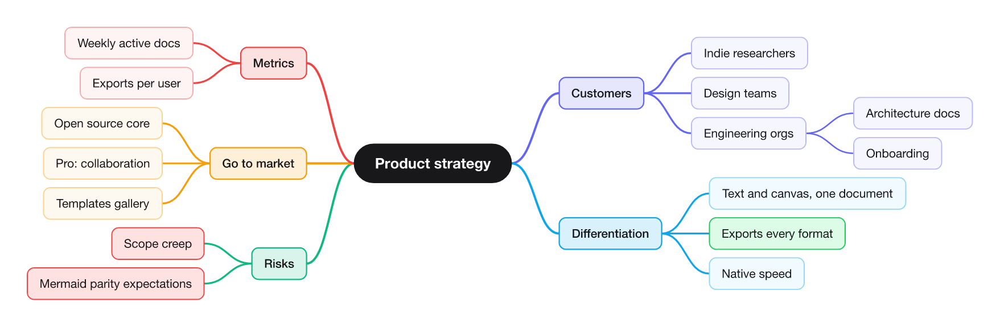
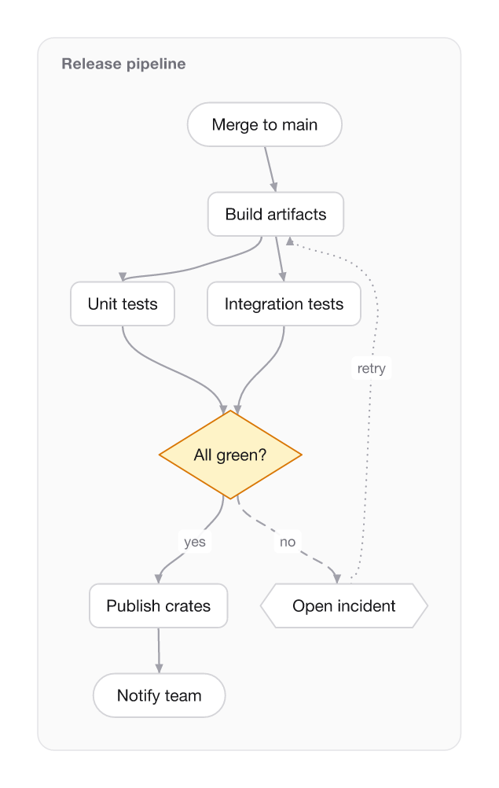

<h1>
  <picture>
    <source media="(prefers-color-scheme: dark)" srcset="assets/brand/logo-dark.svg">
    
  </picture>
</h1>

**Think in graphs. Ship in any format.** Diagrams and mindmaps as plain text, rendered fast and exported to the formats other tools actually read.

<p>
  
</p>

rhizo has one document model and many ways in and out. Write a `.rhizo` file by hand, generate JSON or YAML from a script, or import Mermaid, OPML, FreeMind or an Obsidian canvas. Then render SVG/PNG/PDF, or export to Mermaid, D2, Graphviz, draw.io, GraphML and more.

```kdl
title "Release pipeline"

frame "Release pipeline" layout=layered direction=down {
    node "Merge to main" shape=pill
    node "All green?" id=green shape=diamond
    edge "Merge to main" "Build" "Tests" green
    edge green "Publish" label="yes"
    edge green "Open incident" label="no" line=dashed
}
```



## Install and use

```bash
cargo install --path crates/cli
```

```bash
rhizo new mindmap > idea.rhizo     # starter file (mindmap, flow, canvas)
rhizo render idea.rhizo            # → idea.svg
rhizo render idea.rhizo -o idea.pdf --theme paper
rhizo convert flow.mmd -o flow.rhizo
rhizo convert idea.rhizo -o idea.drawio
rhizo watch idea.rhizo -o idea.png # re-render on save
rhizo check *.rhizo                # diagnostics with source spans
rhizo fmt idea.rhizo               # canonical formatting
rhizo schema > rhizo.schema.json   # JSON Schema for the JSON/YAML forms
```

A native viewer follows the file as you edit it, in any editor:

```bash
cargo run --release -p rhizo-app -- idea.rhizo   # scroll pans, cmd+scroll/pinch zooms, F fits, 0 = 100%
```

## The format

rhizo files are [KDL v2](https://kdl.dev). Every statement is one line, nesting means "child of", and labels double as ids.

| Statement | Meaning |
|---|---|
| `- "Label" { ... }` | A node; nested `-` lines are its children. `node "Label"` is the same thing. |
| `edge a b c label="x"` | Edges a→b and b→c. Refer to nodes by id, by label, or by the slug of a label. A name that matches nothing creates a node. |
| `frame "Title" layout=... { ... }` | A region with its own layout. A document can mix a mindmap, a flowchart and a free canvas. |
| `style "name" fill="#..."` | A named style. Apply it with `class=name`. |
| `title`, `theme`, `layout`, `direction` | Document settings. `layout` and `direction` apply to nodes outside frames. |

**Layouts.** `mindmap` (balanced, branch colored), `tree` (tidy, org-chart style), `layered` (flowcharts and DAGs), `force` (networks: graph distance becomes drawing distance), `grid`, `free` (nodes keep `x`/`y`), and `auto`: layered if there are edges, mindmap if there is nesting, otherwise grid.

**Node properties.** `id`, `class`, `shape` (`rect` `rounded` `pill` `ellipse` `circle` `diamond` `hexagon` `text`), `fill`, `stroke`, `text`, `stroke-width`, `font-size`, `font-weight`, `line` (`solid` `dashed` `dotted`), `x`, `y`, `note`, `link`, `tags`.

**Edge properties.** `label`, `arrow` (`end` `start` `both` `none`), `line`, `class`, `stroke`, `stroke-width`.

**Themes.** `light`, `dark`, `paper`. Styles cascade: theme → layout defaults (root, branch colors) → classes → inline. When you set a fill without a text color, rhizo picks a readable text color for you.

**Typed documents (format version 2).** Nodes, frames and edges can carry a namespaced `type`, a `props` object, ports, acceptance criteria and provenance. Kits (coming next) give types their meaning; today rhizo stores, checks and round-trips them. Plain documents are unaffected and stay version 1.

```kdl
rhizo version=2
use infra version="0.1"

node "Receipts" id=receipts type=aws.s3.bucket {
    props versioning=#true {
        lifecycle { - prefix="tmp/" expire-after-days=7 }
    }
    port out "created" kind=data
    accept "Objects are encrypted at rest"
}
edge orders-fn receipts kind=data { props access="write" }
```

`props` blocks follow [JSON-in-KDL](https://github.com/kdl-org/kdl/blob/main/JSON-IN-KDL.md) exactly. Ids can be CURIEs (`id=HP:0001649`) once their `prefix` is declared, and node and edge ids share one namespace. GraphML and draw.io exports keep types and props; other formats drop them with one warning. Design: `docs/design/profiles-and-compiler.md`.

The same document in YAML:

```yaml
title: Plan
nodes:
  - label: Plan
    children: [Research, Build, { label: Ship, shape: pill }]
edges:
  - research -> build
```

## Formats

| Format | Read | Write | Notes |
|---|:-:|:-:|---|
| rhizo (`.rhizo`, `.kdl`) | ✓ | ✓ | native, lossless |
| JSON / YAML | ✓ | ✓ | same schema, lossless; `rhizo schema` |
| Mermaid (`.mmd`) | ✓ | ✓ | flowchart/graph and mindmap; stateDiagram import |
| D2 (`.d2`) | | ✓ | |
| Graphviz (`.dot`) | | ✓ | |
| OPML | ✓ | ✓ | outlines |
| FreeMind / Freeplane (`.mm`) | ✓ | ✓ | includes cross links; XMind can import `.mm` |
| Markdown | ✓ | ✓ | headings and lists, markmap style |
| JSON Canvas (`.canvas`) | ✓ | ✓ | Obsidian; with positions |
| draw.io (`.drawio`) | | ✓ | diagrams.net and Confluence; with positions |
| GraphML | | ✓ | yEd, Gephi, Cytoscape, networkx |
| SVG / PNG / PDF | | ✓ | semantic, accessible SVG; PDF with real, selectable text |

## Architecture

```
crates/
  core/     document model, styles, themes, colors        (no native deps)
  lang/     KDL parser and writer, JSON/YAML, diagnostics  (no native deps)
  layout/   tidy trees, mindmaps, layered graphs, grid     (no native deps)
  render/   SVG writer; PNG via resvg; PDF via krilla
  interop/  every other format
  cli/      the `rhizo` binary
```

Everything above `render` builds for `wasm32-unknown-unknown`, which CI checks, so a web viewer and editor can share the exact same engine.

**Layout engines.**
- Trees use non-layered tidy-tree packing with contours, so small subtrees tuck in beside large ones instead of being stacked as bounding boxes. Iterative and O(n · contour).
- Graphs use Sugiyama-style layering: DFS cycle breaking, longest-path layering, Fenwick-tree crossing counts, barycenter sweeps with transposition, and coordinate assignment by exact weighted isotonic regression, which keeps long edges straight.

**Speed.** On an M-series Mac, release build, including loading system fonts, `rhizo render` takes about 0.4 s for a 5,000-node mindmap and 0.6 s for a 1,500-node flowchart.

## Roadmap

1. ~~Core model, text format, layouts, SVG/PNG/PDF, CLI~~
2. ~~Interop: Mermaid, D2, DOT, OPML, FreeMind, Markdown, JSON Canvas, draw.io, GraphML~~
3. Native editor (wgpu + vello): canvas and text side by side, live sync both ways
4. Force-directed layout, network simplex layering, edge-label-aware routing
5. Vega-Lite chart nodes, WASM plugins for custom formats and layouts, web viewer

## License

MIT OR Apache-2.0
